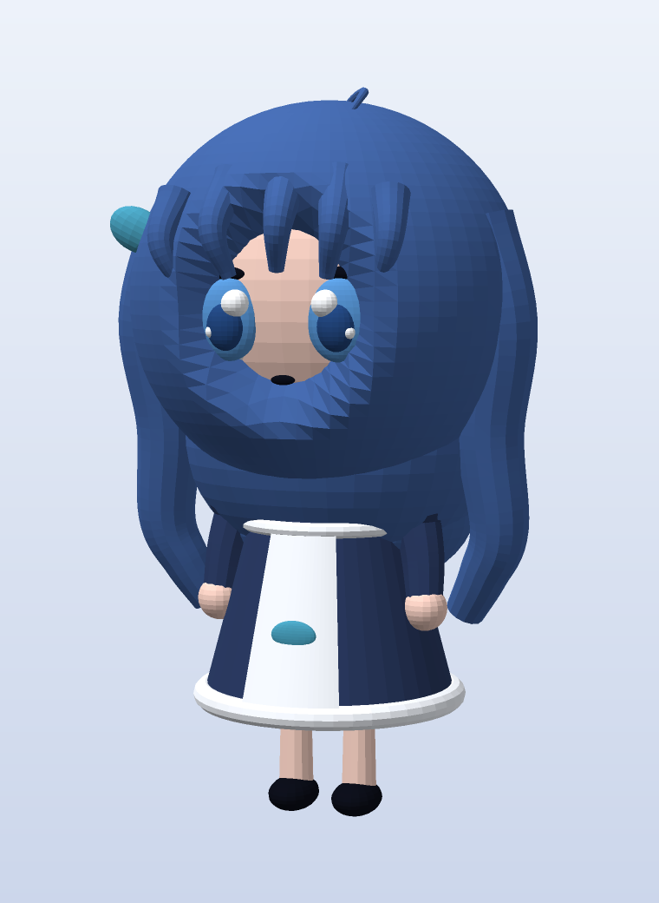

**English** | [简体中文](README.zh-CN.md)

# shenshen · 3D Model

A **stylized low-poly 3D reconstruction** built from the frame assets of the `shenshen` desktop-pet
character (idle frames + a 360° turntable): blue hair, white lace maid headdress, navy maid dress with a
white apron and a whale emblem, and chibi proportions.



## Files

| File | Purpose |
|---|---|
| `shenshen.glb` | glTF binary with materials (12 material slots); opens in Blender, online glTF viewers, or the Windows 3D Viewer |
| `shenshen.obj` + `shenshen.mtl` | Generic OBJ (split by material via `usemtl`); works in almost every DCC tool |
| `shenshen.stl` | Binary STL for slicers (Cura / PrusaSlicer / Bambu Studio) |
| `hero.png` | Hero render (3/4 view) |
| `preview.png` | Four views (front / 3/4 / side / back) |
| `turntable.gif` | 24-frame turntable animation |
| `build.py` | Model generation script — tweak proportions and colors here |
| `mesh.py` | Primitives and exporters (sphere / ellipsoid / frustum / ring / swept tube / curved plate → OBJ/STL/GLB) |
| `render.py` / `preview.py` / `animate.py` | Pure-numpy software rasterizer + preview / turntable rendering |
| `ref/` | Reference frames extracted from the source assets |

## Dimensions

- Total height **2.276** units (feet at y≈0, including the ahoge), width ±0.68, depth ±0.62.
- Scale: 1 unit = 1 cm, so the model is roughly 22.8 cm tall. For a 12 cm figurine, scale by **0.53**.

## Structure

- 25,948 vertices / 47,500 triangles / 12 materials: hair (dark blue / bright blue / dim blue), skin,
  lace white, dress navy, shoe black, eye white, iris, pupil, and teal (bow + whale emblem).
- Assembled from ~50 primitives: head (ellipsoid), hair shell (a sphere shell with a "face cavity" so the
  face shows through), back-hair volume, wavy side locks, bangs, ahoge, lace headband (curved swept tube +
  16 lace spheres), eyes / pupils / highlights / lashes, ear bows, neck, frustum skirt, rounded hem,
  frills, apron (curved plate fitted to the cone), collar, waistband, whale emblem, puff sleeves, arms,
  hands, legs, shoes, and the little whale tail behind.

## Known limitations

- **Parts are separate closed shells that interpenetrate; no boolean merge.** Fine for rendering and
  viewing. Slicers usually cope with multiple shells, but for a truly watertight single solid you need a
  `Boolean Union` / `Voxel Remesh` pass in Blender.
- **No rig, no UVs.** Colors are per-material flat colors and the face is geometry rather than a texture,
  so the eye detail and hair gradients of the original art are absent.
- This is a **stylized 3D interpretation**, not an official model, and it is not meant to be pixel-perfect
  against the 2D artwork.

## Regenerating

```powershell
# requires numpy (bare Python 3.14 on this machine)
python -m pip install numpy
python build.py      # writes shenshen.obj / .mtl / .stl / .glb
python preview.py    # writes preview.png (four views)
python animate.py    # renders 24 frames to frames/
ffmpeg -framerate 12 -i frames/f_%03d.png -vf palettegen palette.png
ffmpeg -framerate 12 -i frames/f_%03d.png -i palette.png -lavfi paletteuse turntable.gif
```

The renderer is a pure-numpy z-buffer rasterizer (no Blender / OpenGL on this machine), which is why the
outputs look "low-poly flat-shaded".

## License

No license file yet — until one is added, assume all rights reserved. If you want others to reuse the
model or scripts, pick one (e.g. MIT for the code, CC BY 4.0 for the meshes) and drop it in `LICENSE`.
