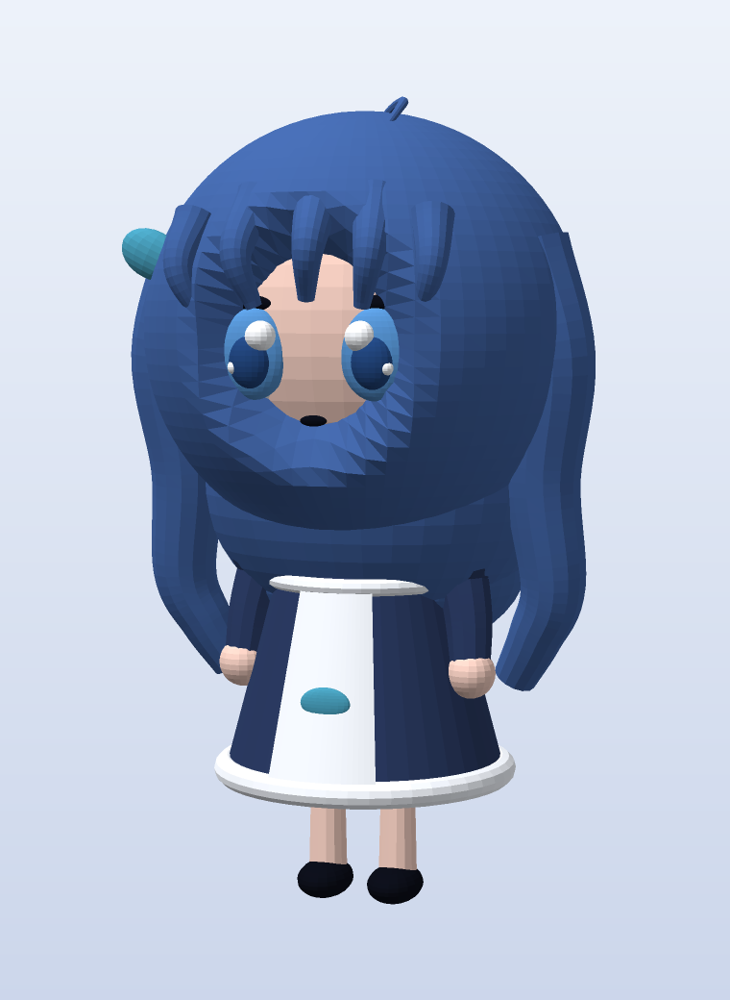

[English](README.md) | **简体中文**

# shenshen · 3D 模型

依据桌宠本体 `D:\dsh-pet\_internal\assets\characters\shenshen` 的帧素材（待机 + 原地 360° 旋转展示）
做的**风格化低多边形 3D 重建**：蓝发、白色蕾丝女仆头饰、藏青女仆裙 + 白围裙 + 鲸鱼徽记、chibi 大头比例。



## 文件

| 文件 | 用途 |
|---|---|
| `shenshen.glb` | 带材质的 glTF 二进制（12 个材质槽），Blender / 在线的 glTF 查看器 / Windows「3D 查看器」可直接打开 |
| `shenshen.obj` + `shenshen.mtl` | 通用 OBJ（按材质分 `usemtl`），几乎所有 3D 软件都认 |
| `shenshen.stl` | 二进制 STL，给切片软件（Cura / PrusaSlicer / Bambu Studio）用 |
| `hero.png` | 主视觉渲染（3/4 视角） |
| `preview.png` | 四视图（正面 / 3/4 / 侧面 / 背面） |
| `turntable.gif` | 24 帧转盘动画 |
| `build.py` | 模型生成脚本（改比例、改颜色都在这里） |
| `mesh.py` | 基元与导出（球 / 椭球 / 锥台 / 环 / 扫掠管 / 弧形板，OBJ/STL/GLB 导出） |
| `render.py` / `preview.py` / `animate.py` | 纯 numpy 软件光栅渲染器 + 预览 / 转盘 |
| `ref/` | 从素材里取的参考帧 |

## 尺寸

- 总高 **2.276** 单位（脚底 y≈0，头顶含呆毛），左右最宽 ±0.68，前后 ±0.62。
- 比例换算：1 单位 = 1 cm → 高约 22.8 cm；3D 打印想做成 12 cm 手办，缩放 **0.53**。

## 结构

- 25,948 顶点 / 47,500 三角面 / 12 个材质：发色（深蓝 / 亮蓝 / 暗蓝）、肤色、蕾丝白、裙色、鞋黑、
  眼白、虹膜、深瞳、青绿（蝴蝶结 + 鲸鱼徽记）。
- 由 ~50 个基元拼装：头（椭球）、发壳（带「脸部凹坑」的球壳，让脸露出来）、后发体积、两侧波浪长发、
  刘海束、呆毛、蕾丝发带（弧形扫掠管 + 16 颗蕾丝球）、眼/瞳/高光/睫毛、耳朵处的蝴蝶结、
  颈部、锥台裙身、圆角裙摆、荷叶边、围裙（贴合锥面的弧形板）、领口、腰封、鲸鱼徽记、
  泡泡袖、手臂、手、腿、鞋、身后的小鲸鱼尾巴。

## 已知限制

- **部件是互相穿插的独立闭合壳，没有做布尔合并**：渲染和看没问题；3D 打印时切片器一般能处理多壳，
  但想要真正水密的单一实体，需要在 Blender 里做一次 `Boolean Union` / `Voxel Remesh`。
- **没有骨骼绑定，没有 UV 贴图**：颜色按材质给（flat 色），脸是几何体而不是贴图，所以没有原画那种
  眼睛细节和发丝渐变。
- 这是一个**风格的 3D 诠释**，不是官方模型，也不指望和 2D 立绘逐像素一致。

## 重新生成

```powershell
# 需要 numpy（本机 Python 3.14 裸装）
python -m pip install numpy
python build.py      # 写 shenshen.obj / .mtl / .stl / .glb
python preview.py    # 写 preview.png（四视图）
python animate.py    # 渲染 24 帧到 frames/
ffmpeg -framerate 12 -i frames/f_%03d.png -vf palettegen palette.png
ffmpeg -framerate 12 -i frames/f_%03d.png -i palette.png -lavfi paletteuse turntable.gif
```

渲染器是纯 numpy 的 z-buffer 光栅器（本机没有 Blender / OpenGL），所以出图偏「低多边形平涂」风格。
