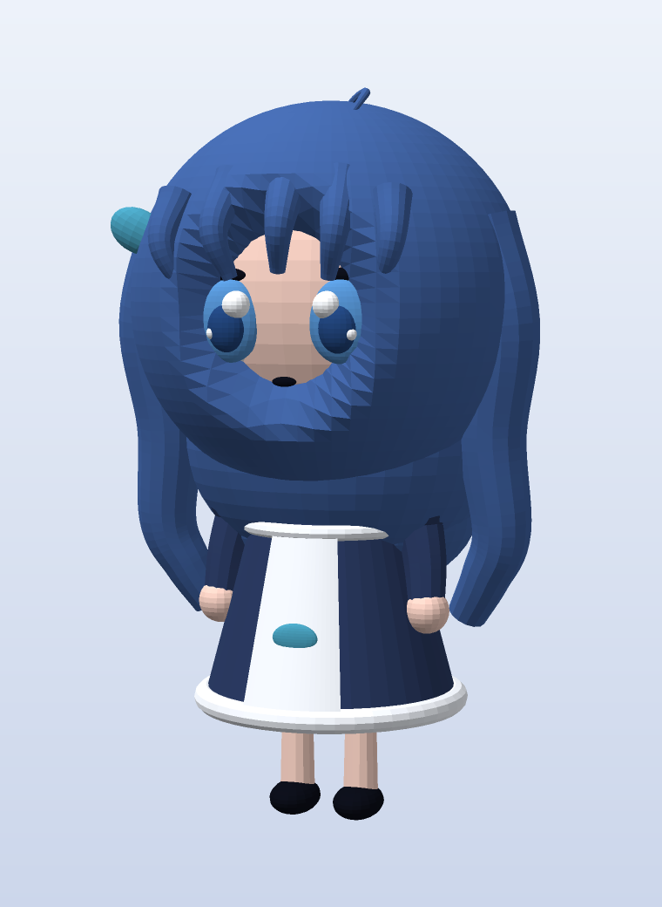

**简体中文** | [English](README.md)

# shenshen · 3D 模型

依据桌宠角色 `shenshen` 的帧素材（待机帧 + 原地 360° 转盘）做的**风格化低多边形 3D 重建**：
蓝发、白色蕾丝女仆头饰、藏青女仆裙配白围裙与鲸鱼徽记，以及 chibi 的大头比例。



## 文件

| 文件 | 用途 |
|---|---|
| `shenshen.glb` | 带材质的 glTF 二进制（12 个材质槽）；Blender、在线 glTF 查看器、Windows「3D 查看器」都能直接打开 |
| `shenshen.obj` + `shenshen.mtl` | 通用 OBJ（通过 `usemtl` 按材质分组），几乎所有 3D 软件都支持 |
| `shenshen.stl` | 二进制 STL，供切片软件（Cura / PrusaSlicer / Bambu Studio）使用 |
| `hero.png` | 主视觉渲染（3/4 视角） |
| `preview.png` | 四视图（正面 / 3/4 / 侧面 / 背面） |
| `turntable.gif` | 24 帧转盘动画 |
| `build.py` | 模型生成脚本——调比例、调颜色都在这里改 |
| `mesh.py` | 基元与导出（球 / 椭球 / 锥台 / 环 / 扫掠管 / 弧形板 → OBJ/STL/GLB） |
| `render.py` / `preview.py` / `animate.py` | 纯 numpy 软件光栅渲染器 + 预览 / 转盘渲染 |
| `ref/` | 从原始素材中提取的参考帧 |

## 尺寸

- 总高 **2.276** 单位（脚底位于 y≈0，含头顶呆毛），左右最宽 ±0.68，前后 ±0.62。
- 换算：1 单位 = 1 厘米，模型高约 22.8 厘米。想做 12 厘米手办，整体缩放 **0.53**。

## 结构

- 25,948 顶点 / 47,500 三角面 / 12 个材质：发色（深蓝 / 亮蓝 / 暗蓝）、肤色、蕾丝白、裙色藏青、鞋黑、
  眼白、虹膜、瞳孔、青绿（蝴蝶结与鲸鱼徽记）。
- 由约 50 个基元拼装：头（椭球）、发壳（带「脸部空腔」的球壳，让脸露出来）、后发体块、两侧波浪长发、
  刘海、呆毛、蕾丝发带（弧形扫掠管 + 16 颗蕾丝球）、眼睛 / 瞳孔 / 高光 / 睫毛、耳侧蝴蝶结、颈部、
  锥台裙身、圆角裙摆、荷叶边、围裙（贴合锥面的弧形板）、领口、腰封、鲸鱼徽记、泡泡袖、手臂、手、
  腿、鞋，以及身后的小鲸鱼尾巴。

## 已知限制

- **各部件是互相穿插的独立闭合壳体，没有做布尔合并。** 渲染和查看都没问题；切片软件一般能处理多壳体，
  但要得到真正水密的单一实体，需要在 Blender 里做一次 `Boolean Union` / `Voxel Remesh`。
- **没有骨骼绑定，也没有 UV。** 颜色按材质给的是平面色，脸是几何体而非贴图，因此缺少原画的眼睛细节和
  发丝渐变。
- 这是对原作的**风格化 3D 诠释**，并非官方模型，也不追求与 2D 立绘像素级一致。

## 重新生成

```powershell
# 需要 numpy（本机为裸装 Python 3.14）
python -m pip install numpy
python build.py      # 生成 shenshen.obj / .mtl / .stl / .glb
python preview.py    # 生成 preview.png（四视图）
python animate.py    # 渲染 24 帧到 frames/
ffmpeg -framerate 12 -i frames/f_%03d.png -vf palettegen palette.png
ffmpeg -framerate 12 -i frames/f_%03d.png -i palette.png -lavfi paletteuse turntable.gif
```

渲染器是纯 numpy 的 z-buffer 光栅器（这台机器上没有 Blender / OpenGL），所以出图呈「低多边形平涂」风格。

## 许可证

目前还没有 LICENSE 文件——在补充之前，请视为保留所有权利。若希望他人复用模型或脚本，可以选定一种许可
（例如代码用 MIT、网格模型用 CC BY 4.0）并放入 `LICENSE`。
